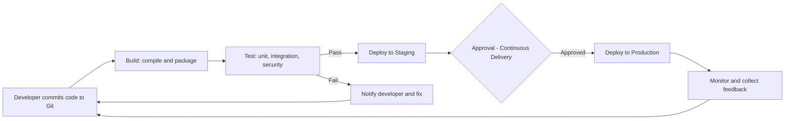

# DevOps Practices and CI/CD Pipelines

**Student Name:** Aaliya

**USN:** NB25CSE003

**Department:** Computer Science Engineering

**Assigned Case Study:** Question 3 – DevOps Practices and CI/CD Pipelines
---

## 1. Introduction

**DevOps** is a set of practices that brings software **Dev**elopment and IT **Op**erations together so that software can be built, tested, released and monitored faster and more reliably. Instead of developers "throwing code over the wall" to an operations team, both share responsibility for the whole life cycle. The main ideas are collaboration, automation, continuous feedback and continuous improvement.

### Continuous Integration (CI)
Developers merge their code changes into a shared repository frequently (several times a day). Each merge automatically triggers a build and a set of tests, so integration problems and bugs are caught within minutes, not weeks.

### Continuous Delivery (CD)
Every change that passes the automated tests is automatically prepared and kept in a **release-ready** state. Deployment to production still needs a **manual approval** (a button click).

### Continuous Deployment (CD)
Goes one step further: every change that passes all automated checks is **deployed to production automatically**, with no human approval.

| Aspect | Continuous Integration | Continuous Delivery | Continuous Deployment |
|---|---|---|---|
| Focus | Merge, build and test code | Keep code always release-ready | Release automatically |
| Production release | No | Manual approval | Fully automatic |

---

## 2. Problem Analysis

A software company develops an **online shopping application**. Developers update it often to add features and fix bugs, but the current process is manual. This causes:

- **Delays:** testers must run test cases by hand, and releases wait for people to be available.
- **Errors:** manual deployment steps are easy to skip or do wrongly (wrong configuration, missing file, wrong version).
- **Late bug detection:** bugs are found only after a large amount of code has been merged, so they are costly to fix.
- **Inconsistent environments:** code that works on a developer's laptop fails on the server.
- **Slow feedback and risky releases:** large, infrequent releases are hard to roll back.

For an online shop, such delays and errors mean lost sales, unhappy customers and security risks during checkout and payment.

---

## 3. Proposed Solution

Adopt **DevOps practices** and build an automated **CI/CD pipeline** (for example with GitHub Actions, Jenkins or GitLab CI) so that every code change automatically flows from commit to production.

### DevOps practices applied

- **Version control (Git):** all code and configuration is stored in a repository, with feature branches and pull requests.
- **Automation:** build, test and deployment are scripted, not manual.
- **Infrastructure as Code (e.g., Terraform) and containers (Docker):** identical environments everywhere.
- **Monitoring and feedback:** logs and alerts show problems quickly after release.

### CI/CD pipeline stages

1. **Source / Commit:** a developer pushes code or opens a pull request; the pipeline starts automatically.
2. **Build:** the code is compiled and dependencies are installed. The application is packaged into an artifact or Docker image.
3. **Test:** automated tests run: unit tests, integration tests (cart, payment, order APIs), and code quality / security scans. If any test fails, the pipeline stops and the developer is notified.
4. **Release / Staging:** the tested build is deployed to a staging environment that mimics production, where final checks (smoke tests, performance tests) run.
5. **Deploy:** the build is released to production, using safe strategies such as blue-green or rolling deployment. An approval gate is added for Continuous Delivery; none is needed for Continuous Deployment.
6. **Monitor and feedback:** tools track errors, speed and availability. Problems are fed back to developers, and a rollback can be triggered if needed.

### Build, Test and Deployment explained

- **Build:** converts source code into a runnable package. A build that fails immediately shows that the new code breaks something.
- **Test:** automated test suites check that the new change works and that old features have not broken (regression testing). They replace slow manual testing.
- **Deployment:** the same script deploys the tested package to servers every time, so the result is repeatable and free of manual mistakes.

### CI/CD Pipeline Diagram



Text version:

```
Commit -> Build -> Test -> Staging -> (Approval) -> Production -> Monitor
   ^                 |                                              |
   |_____ fix <------|                                              |
   |______________________ feedback ________________________________|
```

---

## 4. Benefits and Challenges

### Benefits of automation

1. **Faster releases:** new features and bug fixes reach customers in hours or days instead of weeks, because build, test and deployment run without waiting for people.
2. **Higher quality and fewer errors:** automated tests run on every change, so bugs are caught early, and scripted deployments remove manual mistakes.
3. **Reliable, lower-risk releases:** small, frequent releases are easier to test and to roll back, and developers spend less time on repetitive work and more on building features.

### Challenges

- **Initial setup effort and cost:** building the pipeline, writing automated tests and learning the tools takes time.
- **Cultural change:** teams must adopt shared responsibility and good testing habits.
- **Test and pipeline maintenance:** weak or slow tests reduce trust in the pipeline, and pipeline scripts need regular updates.
- **Security:** secrets (passwords, API keys) must be managed carefully in the pipeline.

---

## 5. Conclusion

Manual testing and deployment cause the delays and errors faced by the online shopping company. By adopting DevOps practices and an automated CI/CD pipeline (commit, build, test, staging, deploy, monitor), every change is validated automatically and released consistently. The result is faster delivery, better quality, lower risk and quicker feedback. Despite the initial setup effort, the long-term benefits make CI/CD a key practice in modern software engineering.

---

## References

- Atlassian, "What is DevOps?" and "CI/CD".
- GitHub Docs, "Understanding GitHub Actions".
- Humble, J. and Farley, D., *Continuous Delivery*, Addison-Wesley.
